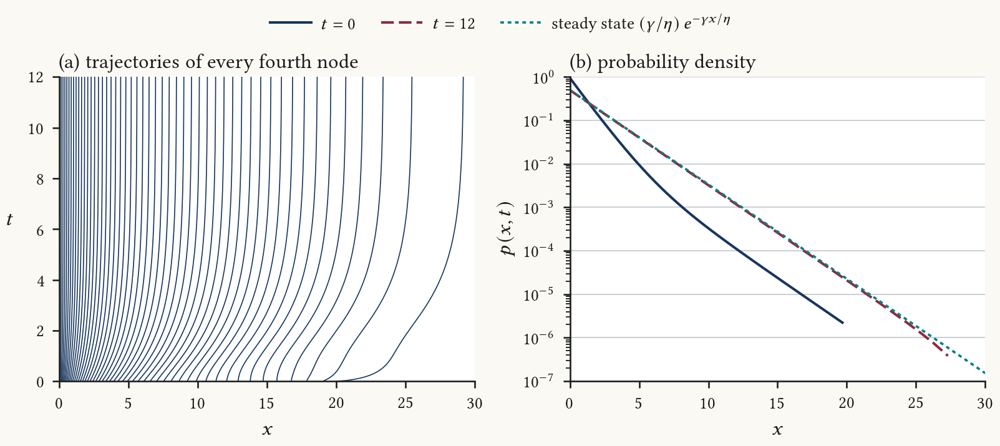
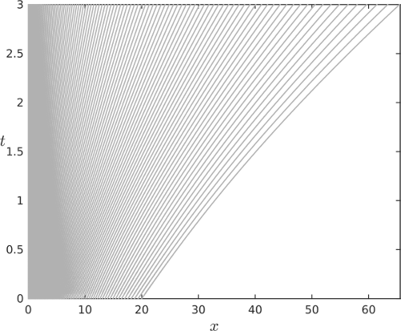

<!-- Author: Dr. Denys Dutykh (Mathematics Department, Khalifa University of Science and Technology, Abu Dhabi, UAE) -->

# Feller: an adaptive Lagrangian scheme for Feller's diffusion equation on the half-line



The run of the shipped script `sources/runFeller.m` with its own parameters: drift γ = 0.5, diffusion η = 1, 200 nodes
initially spread over 0 ⩽ x ⩽ 20, integration by `ode45` up to t = 12. Panel (a) shows the trajectories x(t) of every
fourth node: the outer nodes move out quickly at first, to x ≈ 29, then stop, as the confining drift and the diffusion
come to balance. Panel (b) shows the probability density p(x, t) at the start and at the end, on a logarithmic scale,
with the steady state (γ/η) e^(−γx/η) towards which the solution tends.

The MATLAB scripts of this repository solve Feller's diffusion equation, the Fokker–Planck equation of the Feller
process, which arises in probability and in the theory of wave turbulence. The equation is posed on the half-line
x > 0, its diffusion coefficient grows without bound with x, and the support of its solutions may extend to infinity,
so that a fixed grid on a truncated domain serves it badly. The code rewrites it in Lagrangian variables: each node
carries a fixed value of the cumulative probability and moves with the solution, so that the whole half-line is
covered without truncation. The scheme is described in the article of Denys Dutykh in Mathematics (2019), cited
below.

## The problem

For the probability density p(x, t), with a drift coefficient γ and a diffusion coefficient η > 0, the equation reads

```text
∂p/∂t + ∂F/∂x = 0,    F = − x (γ p + η ∂p/∂x),    x > 0,  t > 0.
```

With the cumulative distribution P(x, t), the integral of p from 0 to x, and its inverse X(P, t), the position at
which the cumulative probability equals P, the variable Y = e^(γt) X obeys equation (8) of the article,

```text
∂Y/∂t + Y ∂/∂P [ η e^(γt) (∂Y/∂P)⁻¹ ] = 0,    0 ⩽ P ⩽ 1.
```

The code follows N nodes, which carry the fixed values P_1 = 0 < P_2 < ... < P_N of the initial distribution; the
derivative in P is replaced by centred differences between neighbouring nodes (one-sided at the last node), the first
node stays at x = 0, and the system of ordinary differential equations for Y_1, ..., Y_N is integrated by `ode45` (the
Dormand–Prince pair 4(5) of MATLAB). The positions are X = e^(−γt) Y, and the density is recovered from the differences
of P between neighbouring nodes. In `runFeller.m` the initial density is the sum of two exponentials,

```text
p(x, 0) = ( e^(−x/2) + e^(−(x−3)) ) / (2 + e³),
```

sampled by the 200 nodes x = 21^((i − 1)/199) − 1, i = 1, ..., 200, from 0 to 20 (the variables `g`, `e` and `N` are γ,
η and N, and the tolerances of `ode45` are 10⁻⁵). For γ > 0 the drift confines the solution and its steady state with
zero flux is (γ/η) e^(−γx/η); for γ < 0 the support expands.

## Quick start

In MATLAB, from the root folder of the repository:

```matlab
cd sources
runFeller
```

The script integrates up to t = 12 with a text progress bar, then draws the density p(x, t) at every fiftieth output
time of `ode45`; with MATLAB R2025b on one core it takes about 15 s, drawing included. The parameters are set at the
top of the script.

## A check of the run

Integrating the equation against x gives a closed law for the mean of the distribution, d⟨x⟩/dt = η − γ⟨x⟩, so that
⟨x⟩ = η/γ + (⟨x⟩₀ − η/γ) e^(−γt), with ⟨x⟩₀ = (4 + e³)/(2 + e³) ≈ 1.090557 for the initial density above. Computed from
the nodes of the run of the figure by the midpoint rule, the mean follows this law to 2 × 10⁻⁵ all along:

```text
t          computed ⟨x⟩    exact ⟨x⟩
0          1.090567        1.090557
2.0002     1.665461        1.665470
3.9888     1.876216        1.876232
7.9967     1.983296        1.983316
12         1.997726        1.997746
```

The probability carried by the nodes is fixed by construction; it is 1 − 4 × 10⁻⁶, the initial probability beyond
x = 20 being left out.



The picture above shows the trajectories of the nodes in the expanding experiment of the article (drift γ = −0.1, up to
t = 3, its Figure 2c), in which the support of the solution more than triples; the shipped script runs the confining
experiment shown at the top of this page, with 200 nodes where the article uses 100.

## Contents

The folder `sources/` holds the script `runFeller.m` (parameters, initial distribution, integration and plots), the
right-hand side `FellerRHS.m` of the system for the nodes, and, in `sources/progress/`, the text progress bar shown
during the integration. The folder `pics/` holds the picture of the expanding experiment. The folder `docs/figures/`
holds the two scripts that make the figure at the top of this page: `feller_readme_data.m` (MATLAB or GNU Octave)
repeats the run of `runFeller.m` without the progress bar and the plots and writes about 400 of its output times to
`feller_nodes.mat`, and `plot_readme_figure.py` (Python 3 with NumPy, SciPy and Matplotlib, and the style file beside
it) draws the figure. Both are run from `docs/figures/`, in this order.

## Requirements

MATLAB, with no toolbox (checked with R2025b). GNU Octave 11.1 runs the integration of `runFeller.m`, but the script
stops at line 68, which asks for the renderer `zbuffer` that Octave does not have. The script
`docs/figures/feller_readme_data.m` runs in both; in MATLAB its last output is that of `runFeller.m` to the last digit,
and in GNU Octave its final node positions agree with those of MATLAB to 7 × 10⁻⁶.

## How to cite

If you use this code, please cite the article:

D. Dutykh, Numerical simulation of Feller's diffusion equation, Mathematics 7, 1067 (2019).

https://doi.org/10.3390/math7111067

```bibtex
@article{Dutykh2019a,
  author = {Dutykh, Denys},
  title = {Numerical {{Simulation}} of {{Feller}}'s {{Diffusion Equation}}},
  journal = {Mathematics},
  year = 2019,
  month = nov,
  volume = {7},
  number = {11},
  pages = {1067},
  doi = {10.3390/math7111067},
  eprint = {1909.10944},
  archiveprefix = {arXiv}
}
```

The button "Cite this repository" in the right-hand column of this page gives the same reference, read from
`CITATION.cff`; the article is open access.

## Licence

GNU General Public License, version 3 or (at your option) any later version (see `LICENSE`). The progress bar of
`sources/progress/` comes from the submission
[Text progress bar for ODEs](https://www.mathworks.com/matlabcentral/fileexchange/28509-text-progress-bar-for-odes) by
David Romero-Antequera on the File Exchange of MATLAB Central, whose `odetpbar.m` calls `textprogressbar.m` by Paul
Proteus; these two files remain the work of their authors and are not covered by the licence of this repository.

## Authors

Denys Dutykh (Mathematics Department, Khalifa University of Science and Technology, Abu Dhabi, UAE) and Laurent Gosse
(Istituto per le Applicazioni del Calcolo, CNR, Rome, Italy), the authors of the code.

https://www.denys-dutykh.com/

Questions and comments are welcome through the issues of this repository.
